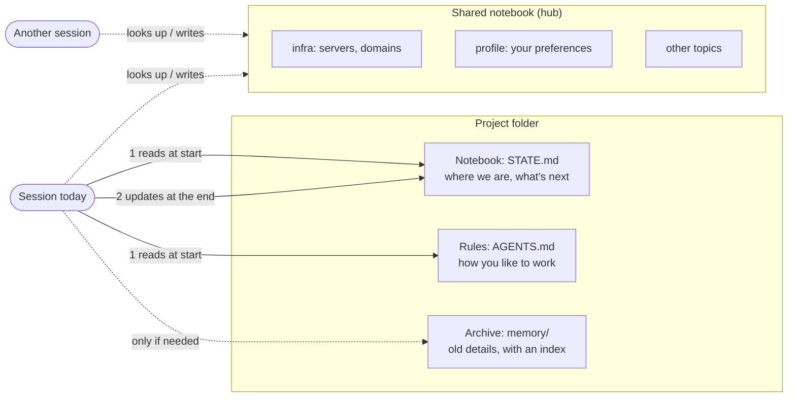

# How it works (no technical background needed)

Think of an assistant that forgets everything when a work session ends.
mnemonic gives it a notebook, kept together with the project.

## The three notebooks
1. **Notebook (STATE.md)**: one page with where the work stands and the next
   steps. Read at the start of every session, rewritten at the end. It never
   grows beyond one page, so reading it always costs the same.
2. **Archive (memory/)**: older details that are not needed every day. It has
   an index, like a library catalogue; the assistant only opens the one
   folder it needs, and only when asked.
3. **Shared notebook (hub)**: knowledge several sessions need, for example
   how the servers are set up. Any session can look something up or write a
   new entry, so sessions stop asking each other the same questions.

## A day of work
1. You open a session. The assistant reads the notebook page and the rules.
   It already knows where you left off; you don't explain again.
2. It works. If it needs an old detail, it checks the archive index first.
   If it needs something another session knows, it checks the shared
   notebook.
3. Before finishing, it rewrites the notebook page: removes what is done,
   adds what comes next, and files away anything worth keeping.

## Why it saves money and time
The assistant pays for everything it reads. Without notebooks it re-reads
old conversations or explores the project again every time, and that cost
grows as the project grows. With notebooks it reads one page. Measured:
26% fewer tokens with only a short history, and the gap widens over time
([benchmark](../tests/bench/RESULTS.md)).

## What never goes in
Passwords, keys or tokens. The shared notebook may say where a secret is
kept, never the secret itself.
