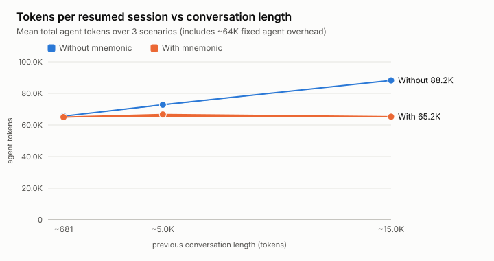
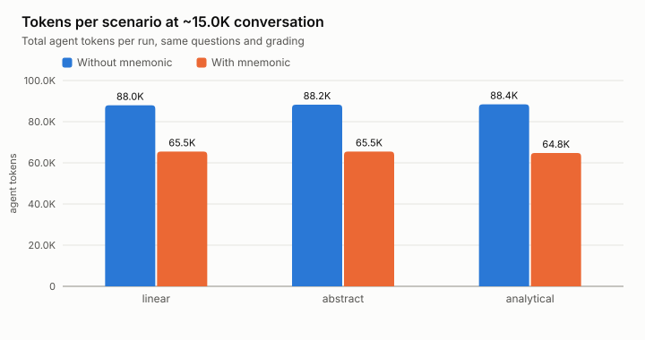
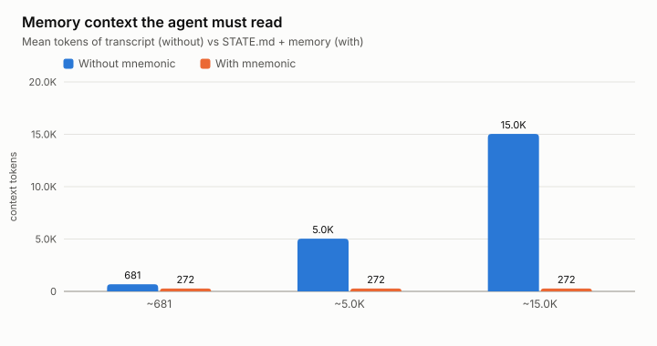

# Results

2026-11-14, mnemonic 0.0.1, small-model subagents, 18 graded runs + 1 rerun.
Full report: [results/report.pdf](results/report.pdf) (also `report.html`),
data: [results/results.csv](results/results.csv).

| Previous conversation | Agent tokens without | with | Saving | Memory context without -> with |
|---|---|---|---|---|
| ~0.7K tokens | 65,607 | 64,998 | 1% | 681 -> 272 |
| ~5K tokens | 72,876 | 66,668 | 9% | 5,031 -> 272 |
| ~15K tokens | 88,215 | 65,246 | 26% | 15,037 -> 272 |

## Findings
- Without memory, tokens grow linearly with the conversation length; with
  mnemonic they stay flat (~65K, almost all fixed agent overhead) because
  STATE.md does not grow.
- Saving reached 26% at only ~15K tokens of history. Real projects
  accumulate far more, so savings keep rising with project age.
- Accuracy: 96/96 answers correct in valid runs, in both conditions,
  including corrected facts and on-demand memory lookups.
- One protocol miss: a "with" run at 5K skipped STATE.md and answered
  "unknown" (0/6). Rerun with identical input: 6/6. Kept in the CSV as
  `5k-failed`. In real installs STATE.md is auto-loaded by the adapter
  import, which removes this failure mode.
- Long-term memory lookups add 2-3 tool calls; cheap compared with reading a
  long transcript.
- Fixed overhead (~64K per agent) hides the saving at small sizes: it is the
  same in both conditions and mnemonic cannot reduce it.
- The baseline is generous: a session without memory normally has no
  transcript and must re-explore code or ask the user.
